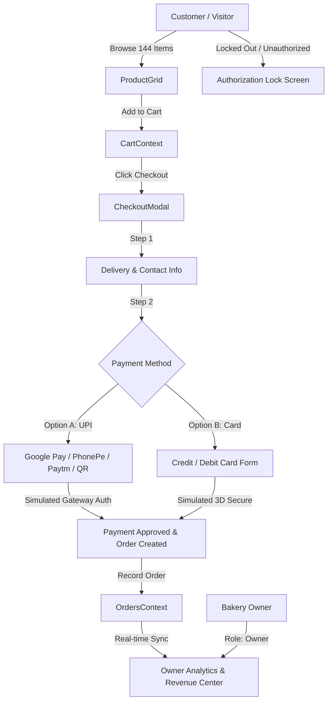

# Authentication, Authorization, UPI & Card Checkout, and Owner Analytics Dashboard

This implementation plan delivers a complete e-commerce flow for **Vatika Bakery**:
1. **Authentication & Authorization Lock (Microservice-style Role Protection)**: Separate roles for Customers and Bakery Owners. Non-owners are locked out of owner/admin management views with security barriers.
2. **Product Purchase & Checkout Flow**: Customers can add any of the 144 bakery items to their cart and checkout using **UPI (Google Pay, PhonePe, Paytm, QR Code, UPI ID)** or **Credit/Debit Card**.
3. **Owner Dashboard & Revenue Analytics**: Bakery Owners can monitor total money earned (revenue), total units sold, which products are selling vs not yet sold, and manage customer orders in real time.

---

## Proposed Architecture & Flow

---

## User Review Required

> [!IMPORTANT]
> - **Demo Accounts for Rapid Testing:**
>   - **Bakery Owner:** `owner@vatika.com` (password: `owner123`) — Has full access to the Owner Revenue & Sales Dashboard.
>   - **Customer:** `customer@vatika.com` (password: `user123`) — Has shopping, cart, and checkout permissions.
>   - Users can also register new accounts with their own email and choose either Customer or Bakery Owner role.
> - **Payment Simulation:**
>   - Real payment gateways require bank credentials and merchant accounts. For safe localhost development, we implement realistic simulated payment verification for both UPI (with live QR code & UPI ID verification) and Credit/Debit Card (with card formatting & 3D secure validation).

---

## Proposed Changes

### 1. State Management & Core Contexts

#### [MODIFY] [`AuthContext.jsx`](file:///c:/Users/shara/OneDrive/Desktop/MyBakrey/mybakery/src/context/AuthContext.jsx)
- Extend `AuthContext` to store user profiles: `{ id, name, email, role: 'customer' | 'owner' }`.
- Persist session and token in `localStorage` (mock microservice auth token).
- Provide `isOwner`, `login(email, password)`, `register(name, email, password, role)`, `logout()`, `requireRole('owner')`.

#### [NEW] [`CartContext.jsx`](file:///c:/Users/shara/OneDrive/Desktop/MyBakrey/mybakery/src/context/CartContext.jsx)
- Manage active shopping cart with persistence in `localStorage`.
- Support `addToCart(product, quantity)`, `removeFromCart(productId)`, `updateQuantity(productId, qty)`, `clearCart()`.
- Compute `totalItemsCount`, `subtotal`, `deliveryFee`, `tax`, and `grandTotal`.

#### [NEW] [`OrdersContext.jsx`](file:///c:/Users/shara/OneDrive/Desktop/MyBakrey/mybakery/src/context/OrdersContext.jsx)
- Central repository for all bakery orders.
- Automatically calculate live Owner Metrics:
  - **`totalRevenue`**: Total money earned (`$`).
  - **`totalItemsSold`**: Total quantity of individual products sold.
  - **`productSalesStats`**: Tracks sales volume and revenue per product across all 144 products, clearly indicating **Sold vs Not Sold** items.
- Actions: `createOrder(orderData)` and `updateOrderStatus(orderId, newStatus)`.

---

### 2. User Authentication & Authorization UI

#### [MODIFY] [`AuthModal.jsx`](file:///c:/Users/shara/OneDrive/Desktop/MyBakrey/mybakery/src/components/AuthModal.jsx)
- Support **Sign In** and **Sign Up** tabs.
- Quick 1-click Demo Buttons: `🔑 Login as Bakery Owner` and `👤 Login as Customer`.
- Form inputs for Email, Password, Name, and Role selection.
- Role badges indicating permissions.

---

### 3. Shopping Cart & Payment Checkout Flow

#### [NEW] [`CheckoutModal.jsx`](file:///c:/Users/shara/OneDrive/Desktop/MyBakrey/mybakery/src/components/CheckoutModal.jsx)
- **Step 1: Delivery Address & Contact**: Name, phone, delivery address, delivery instructions.
- **Step 2: Payment Method Selection**:
  - **UPI Option:**
    - Choose popular UPI apps: Google Pay, PhonePe, Paytm, BHIM.
    - Enter UPI ID (e.g., `name@okaxis`, `name@ybl`) with 1-click verification.
    - Dynamic Vatika Bakery UPI QR Code with live amount.
  - **Credit / Debit Card Option:**
    - Cardholder Name, 16-digit Card Number, MM/YY Expiration, 3-digit CVV.
    - Visual Card brand detection (Visa, Mastercard, RuPay, Amex).
- **Step 3: Gateway Processing Animation:**
  - Realistic loading state ("Connecting to Bank Gateway...", "Validating UPI...", "Payment Authorized!").
- **Step 4: Order Confirmation & Receipt:**
  - Order ID (e.g., `VB-78291`), summary, delivery time estimate, and auto-dispatch to Owner Dashboard.

#### [MODIFY] [`RightSidebar.jsx`](file:///c:/Users/shara/OneDrive/Desktop/MyBakrey/mybakery/src/components/RightSidebar.jsx)
- Connect real items from `CartContext`.
- Real-time quantity adjustments, price calculations, and "Proceed to Checkout" button that triggers `CheckoutModal`.
- Display live active order status for the current user.

#### [MODIFY] [`ProductCard.jsx`](file:///c:/Users/shara/OneDrive/Desktop/MyBakrey/mybakery/src/components/ProductCard.jsx)
- Connect "Add to Cart" directly to `useCart().addToCart(product)`.

---

### 4. Bakery Owner Analytics & Sales Dashboard

#### [NEW] [`OwnerDashboard.jsx`](file:///c:/Users/shara/OneDrive/Desktop/MyBakrey/mybakery/src/components/OwnerDashboard.jsx) (Replacing / Upgrading [`AdminOrders.jsx`](file:///c:/Users/shara/OneDrive/Desktop/MyBakrey/mybakery/src/components/AdminOrders.jsx))
- **Authorization Lock**: If a logged-in user is not an Owner, display an "Access Restricted — Bakery Owner Credentials Required" lock screen with an instant login prompt.
- **Revenue & Financial KPIs ("who may muny i have arane")**:
  - 💰 **Total Money Earned ($ Revenue)**: Prominent stat card displaying total earnings with real-time updates when an order is placed.
  - 🛍️ **Total Products Sold**: Exact count of items sold.
  - 📊 **Order Statistics**: Completed, In Preparation, Out for Delivery, and Pending.
  - 💳 **Payment Channel Split**: Revenue via UPI vs Credit Card.
- **Product Sales Performance ("who many may prodect is sale or not")**:
  - Filter by: **All Products (144)** | **Sold Products** | **Not Sold Yet**.
  - Search products by name or category.
  - Detailed table showing product image, name, category, price, units sold, and total money generated.
- **Live Order Management**:
  - Full list of orders with customer name, phone, items ordered, payment method badge (UPI vs Card), and total amount.
  - Ability for Owner to update status: `Pending` ➔ `In Oven / Baking` ➔ `Out for Delivery` ➔ `Delivered` ➔ `Cancelled`.

---

### 5. Application Assembly

#### [MODIFY] [`Header.jsx`](file:///c:/Users/shara/OneDrive/Desktop/MyBakrey/mybakery/src/components/Header.jsx)
- Show live cart count badge in the header cart button.
- Show "Owner Dashboard" link with shield badge when logged in as Owner.
- User profile menu showing current user name and role (`Customer` vs `Bakery Owner`) with 1-click logout or switch.

#### [MODIFY] [`App.jsx`](file:///c:/Users/shara/OneDrive/Desktop/MyBakrey/mybakery/src/App.jsx)
- Wrap application with `CartProvider` and `OrdersProvider`.
- Integrate `CheckoutModal` and route to `OwnerDashboard`.

---

## Verification Plan

### Automated / Browser Verification
1. **Authentication Testing:**
   - Log in as Customer (`customer@vatika.com`).
   - Attempt to access Owner Dashboard ➔ Verify Authorization Lock screen is displayed.
   - Log in as Owner (`owner@vatika.com`) ➔ Verify Owner Dashboard opens with full analytics.
2. **Shopping & Cart Testing:**
   - Add multiple items from Cakes, Pastries, and Cookies to cart.
   - Verify cart updates in real time with correct quantities and totals.
3. **UPI Payment Flow:**
   - Open Checkout ➔ Fill address ➔ Select UPI ➔ Enter UPI ID / select Google Pay ➔ Complete payment ➔ Verify order confirmation with Order ID.
4. **Credit Card Payment Flow:**
   - Add new item ➔ Select Credit Card ➔ Enter card details ➔ Complete payment ➔ Verify order placed.
5. **Owner Revenue & Sales Verification:**
   - Switch to Owner view ➔ Verify Total Money Earned increased by exact order amount.
   - Verify Total Products Sold increased by the number of purchased items.
   - Verify the newly placed order appears in the order management table with customer name and payment method badge.
   - Verify the Product Sales breakdown correctly marks purchased items as "Sold" and lists units sold.
